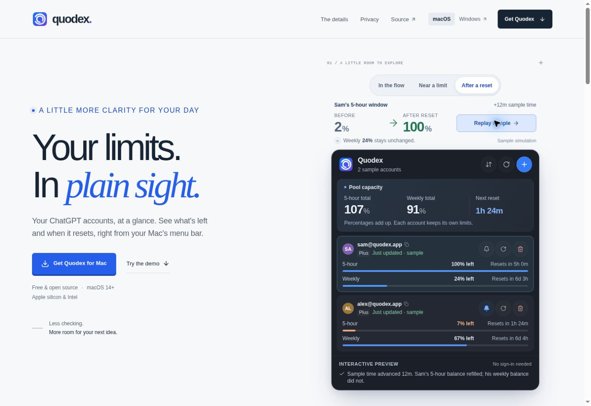

# Quodex visual review

**Review date:** October 21, 2026  
**Website:** quodex.app · `hxbib/quodex-website`  
**Method:** run the page, capture screenshots, inspect the rendered result, then score it. Screenshots preceded scoring in every recorded round.

These are strict internal self-assessments using the weighting requested by the project owner. They are **not official Awwwards jury scores**, an award prediction, or a substitute for user testing. The acceptance condition is **at least 7.5 in every category**; a passing weighted average cannot compensate for a category below 7.5.

**Weighted score = Design × 0.40 + Usability × 0.30 + Creativity × 0.20 + Content × 0.10.**

## Score history

| Reviewed version | Design · 40% | Usability · 30% | Creativity · 20% | Content · 10% | Weighted score | Every category ≥ 7.5?               |
| ---------------- | -----------: | --------------: | ---------------: | ------------: | -------------: | ----------------------------------- |
| Baseline         |          6.7 |             6.3 |              5.8 |           6.6 |       **6.39** | No                                  |
| Round 1          |          7.3 |             7.2 |              7.0 |           7.8 |       **7.26** | No                                  |
| Round 2          |          7.4 |             7.0 |              7.3 |           7.9 |       **7.31** | No                                  |
| Round 3          |          7.5 |             7.6 |              7.5 |           8.0 |       **7.58** | **Yes, for the reviewed rendering** |

Usability fell from Round 1 to Round 2 because the more capable reset simulation exposed a concrete mobile problem. Scores were not required to increase monotonically.

## Baseline — live website before edits

The primary reviewer captured and inspected the live page before assigning the baseline scores. The recorded desktop viewport was 1363 × 936. The first full-page capture did not trigger offscreen reveal animations, so untriggered blank sections were not treated as missing content. The hero and feature section were reviewed in the browser.

| Category   | Assessment                                                                                                                                                  |
| ---------- | ----------------------------------------------------------------------------------------------------------------------------------------------------------- |
| Design     | Consistent native styling, but the wallpaper and repeated glass panels competed with a small product preview.                                               |
| Usability  | Download was apparent, but small demo controls, mobile scaling, weak action feedback, and a simulated flow that opened real authentication reduced clarity. |
| Creativity | Familiar dark wallpaper and feature-card progression; little distinctive explanation of usage windows or resets.                                            |
| Content    | Useful feature and privacy detail, but “live” overstated polling, pooled percentages lacked context, and simulated actions were described as real.          |

**Lowest category: Creativity, 5.8.** The first round needed a coherent visual idea connected to the product, supported by a demonstration that explained account states. Usability and factual-copy defects also required correction.

## Round 1 — clear hierarchy and truthful product explanation

The page was run and screenshots were taken before the round was scored. The review included desktop, privacy, and mobile views; an independent content reviewer inspected the privacy and mobile screenshots.

Changes introduced a light editorial layout, a stronger heading hierarchy, a prominent product demonstration, fewer repeated feature pitches, a clearer installation path, and an explicit privacy diagram. Copy was checked against the native Swift source. Pooled capacity was explained as a sum of account percentages; polling was described as periodic; the demo was identified as sample data without real sign-in.

**Lowest category: Creativity, 7.0.** The presentation had become more coherent, but the demonstration still needed a distinctive, useful interaction that showed why reset information mattered. The next round added a time/reset scenario with observable changes to the sample account data.

Remaining observations included small supporting text, download-architecture ambiguity, and mobile feedback that needed stronger placement. These were recorded as concrete improvements, not grounds to invent stronger product claims.

## Round 2 — working reset simulation, with a mobile visibility problem

The primary reviewer ran the revised page and captured it before scoring. An independent reviewer inspected the desktop hero, reset-result, and mobile screenshots before assigning the scores above.

The simulation could advance a sample account through a reset, change the 5-hour balance, preserve the weekly balance, and update the pooled total. Scenario labels and sample-data wording made its purpose clearer.

**Lowest category: Usability, 7.0.** On mobile, the reset trigger was visible while Sam’s affected usage bars and the resulting explanation were below the fold. The account list also had its own scroll area, so understanding one action could require both page scrolling and account-panel scrolling.

The timeline-like visual did not explain the result strongly enough. Small freshness labels and the pool explanation also remained visually fine-grained.

**Required correction:** put a visible before/after result beside the trigger, bring the affected account into the main view, reduce the height consumed by mobile account controls, and make the independent weekly window explicit.

The default hero screenshot and the reset-result screenshot showed different starting scenarios. Their totals alone were not treated as evidence of the exact reset transition; a matched near-limit/after pair was requested.

## Round 3 — the action and its effect are visible together

The primary reviewer ran the revised page and inspected screenshots before scoring. The independent reviewer directly inspected the final desktop-after and mobile-after screenshots. The primary reviewer also reported checking the corresponding before state and the live transition; the before-image export was temporarily unreliable during the independent review.

The revised demonstration displays **2% → 100%** beside the reset control, states that the **weekly 24% stays unchanged**, and identifies the action as a sample simulation. Sam appears first and receives a visible highlight. A compact mobile account menu reduces card height while retaining 44-pixel controls.

The primary reviewer reported observing the near-limit pooled total change from **9% to 107%**, with the weekly total remaining **91%**. The final screenshots visibly show the 107%/91% result and Sam’s 100%/24% balances. These are illustrative sample values, not live user data.

The earlier mobile blocker is resolved: visitors can understand the reset’s effect from the summary beside the trigger even before scrolling to the account bars.

| Category         | Final assessment                                                                                                                                                                               |
| ---------------- | ---------------------------------------------------------------------------------------------------------------------------------------------------------------------------------------------- |
| Design · 7.5     | Clear typography, coherent spacing and color, and a more readable relationship between the simulation and the app panel. Supporting information has a deliberate place in the hierarchy.       |
| Usability · 7.6  | The action and its result are visible together on desktop and mobile. The affected account is prioritized, sample-state wording is explicit, and the compact mobile controls reduce scrolling. |
| Creativity · 7.5 | The working reset explanation provides a product-specific interaction with meaningful consequences, rather than purely decorative activity.                                                    |
| Content · 8.0    | Product behavior, data freshness, pooled percentages, privacy, and installation are described concretely and checked against the native source.                                                |

### Closest to the threshold

**Design and Creativity, both 7.5.** The useful reset demonstration gives the page its strongest original idea, but the wider composition remains a familiar split hero with a dashboard. This limits the assessment above 7.5; the reviewer did not consider it an 8+ visual design.

One minor remaining issue in the reviewed mobile-after screenshot: **“AFTER RESET” wraps to two lines**, leaving the before/after values slightly misaligned. A shorter visible label such as “AFTER,” or an equal-height label row, would tidy this up. This was classified as polish rather than a remaining acceptance blocker. Any later correction should be verified against a new screenshot.

## Final screenshot evidence

Paths are relative to this document. The final evidence files were restored and checked against their recorded Git blob hashes.

| Screenshot                                         | Intended evidence                                                                                   |
| -------------------------------------------------- | --------------------------------------------------------------------------------------------------- |
| [round3-before.jpg](round3-before.jpg)             | Matched near-limit state before the simulated reset; Sam’s 5-hour balance is 2%.                    |
| [round3-after.jpg](round3-after.jpg)               | Desktop result, visible 2% → 100% explanation, highlighted Sam account, and updated pooled summary. |
| [round3-mobile-after.jpg](round3-mobile-after.jpg) | Mobile result and reset explanation visible beside the trigger; compact account controls.           |
| [round3-mobile-320.jpg](round3-mobile-320.jpg)     | Narrow 320-pixel content-width review; verified at 320-pixel content width.                         |
| [round3-features.jpg](round3-features.jpg)         | Feature-section hierarchy, illustrations, and supporting copy.                                      |
| [round3-privacy.jpg](round3-privacy.jpg)           | Privacy copy and the distinction between local storage and direct requests to OpenAI.               |

## Verification scope and limits

- Website changes are limited to `hxbib/quodex-website`. The native Swift app and separately deployed Windows site are outside this change’s implementation scope.
- The baseline records a 1363 × 936 desktop viewport. Later desktop and embedded mobile screenshots were inspected. The responsive-review harness exposed controls for 375, 390, 768, and 1024 pixels, and later a 320-pixel content view.
- The presence of a width control is not evidence that every width received complete interaction testing. The verified viewport matrix and full regression results are recorded below. This review does not claim independent 768/1024 interaction coverage.
- Screenshot review establishes the visible layout and copy. It does not independently establish screen-reader behavior, keyboard behavior, clipboard success, download completion, or native macOS installation. Those require separate recorded checks.
- The independent final reviewer directly inspected `round3-after.jpg` and `round3-mobile-after.jpg`. The primary reviewer inspected the remaining final evidence. The independent reviewer did not inspect every image.
- The existing Cloudflare Git deployment remains the intended deployment path. A historical Sites project identifier is not a new publication target. This document alone does not verify a production deployment.

## Recorded regression checks

The primary reviewer completed the following browser checks on the final implementation:

- **Responsive geometry:** no horizontal overflow at content widths of 320, 360, 375, 753, 1009, and 1348 pixels. Embedded review frames were used for the smaller widths; these were CSS viewport checks in Chrome, not physical-device tests.
- **Reset behavior:** near-limit state showed 9% pooled 5-hour capacity; advancing 12 sample minutes produced 107%. The pooled weekly value stayed at 91%, and Sam's individual weekly value stayed at 24%.
- **Refresh behavior:** refreshing all accounts changed the freshness labels without spending or changing the sample allowance.
- **Account actions:** sorting put the soonest reset first. Adding samples stopped at the demo's eight-account limit. Removing every sample reached an explicit empty state, and restoring samples worked.
- **Keyboard and menus:** the add/remove dialogs accepted Escape and returned focus. The mobile account menu closed with Escape and restored focus. Sample alert toggling produced visible status feedback without requesting OS notification permission.
- **Installation and FAQ:** source/Homebrew switching showed the correct commands. Clipboard failure on the HTTP preview produced usable manual-copy guidance. The pooled-capacity FAQ opened and explained the sum correctly.
- **Build:** `npm run check` passed lint, TypeScript, and all five production-build phases. `git diff --check` passed.

Limits: successful clipboard copying over production HTTPS was not exercised. Safari, physical mobile devices, native app installation, and a full screen-reader audit were not tested. The 404 source and build were checked; its direct browser navigation was blocked by the browser environment, so there is no claim of a rendered 404 review.

## Recovery verification

The local checkout disappeared during publication after Round 3. The reviewed screenshots, rendered browser document, source edit history, and one uploaded Git blob survived. Recovery preserved the final visual design and behavior:

- Both interactive components, the demo stylesheet, metadata, 404 component, package configuration, and Vite configuration match their original final Git blob hashes exactly.
- The static server page and global stylesheet were restored from the retained rendered document and stylesheet rules, then formatted and rebuilt.
- A fresh `npm run check` passed after recovery.
- The recovered page was run and new desktop and 320-pixel mobile screenshots were inspected **before** confirming the same category scores: **7.5 / 7.6 / 7.5 / 8.0**, weighted **7.58**.
- The recovered mobile reset again changed 9% to 107% pooled 5-hour capacity while the weekly pool stayed at 91%. The FAQ was opened and visually inspected at 320 pixels. No horizontal overflow was present in the recovered 320-pixel or desktop view.
- The temporary responsive harness was removed from the source before committing. It is not part of the production deliverable.

The remaining lowest-category limitations are unchanged: the composition is familiar enough to hold Design and Creativity to 7.5, and the narrow reset label can wrap. No score was increased because recovery succeeded.

### New recovery evidence

- [Recovered default desktop](recovery-hero.jpg)
- [Recovered desktop after reset](recovery-after.jpg)
- [Recovered 320-pixel mobile after reset](recovery-mobile-320.jpg)

### Earlier round evidence

- Baseline: [hero](baseline-hero.jpg)
- Round 1: [hero](round1-hero.jpg), [features](round1-features.jpg), [privacy](round1-privacy.jpg), [installation](round1-install.jpg), [mobile](round1-mobile.jpg), [mobile demo](round1-mobile-demo.jpg)
- Round 2: [hero](round2-hero.jpg), [reset](round2-reset.jpg), [mobile](round2-mobile.jpg), [FAQ](round2-faq.jpg)

## Delivery scope

The reviewed source is prepared on a feature branch for a draft pull request into `main`. Production publication remains the repository's existing Cloudflare Git workflow. No historical Sites project was deployed, and the native Swift app and Windows website were not modified.
